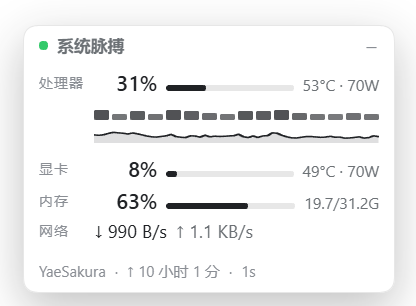

# System Pulse · 系统脉搏

一块浮在 DSH Web 界面右上角的实时系统监控卡片。拖标题栏可移动、位置会记住；点 `–` 收成一个圆环。



```
┌──────────────────────────────┐
│ ● 系统脉搏                 –  │
│ 处理器  41%  ▬▬▬  64°C · 107W│
│ ▁▂▁▃▂▅▃▂▁▂▁▃▂▅▃▂              │  ← 16 个逻辑核，瞬时占用
│      ╱╲___╱╲__╱╲__            │  ← 最近 60 秒 CPU 趋势
│ 显卡    12%  ▬▬   48°C · 35W  │
│ 内存    56%  ▬▬▬  18.0/32.0G  │
│ 网络    ↓ 1.0 MB/s ↑ 93 KB/s  │
│ YaeSakura · ↑ 2h 14m · 1s     │
└──────────────────────────────┘
```

## 功能

| 行 | 内容 | 数据来源 |
|---|---|---|
| 处理器 | 总占用、逐核占用、60 秒趋势、封装温度、封装功耗、风扇 | `os.cpus()` 差分 + Windows 性能计数器 + LibreHardwareMonitor |
| 显卡 | 利用率、显存、温度、功耗、频率 | `nvidia-smi`（缺省时回退 LibreHardwareMonitor） |
| 内存 | 已用/总量与占用率 | `os.totalmem` / `os.freemem` |
| 网络 | 上下行实时速率 | Windows `Get-Counter`（Linux 走 `/proc/net/dev`） |

设计上的几点取舍：

- **1 Hz 轮询**而不是 SSE：一个 `GET /api/system-pulse/snapshot` 就能拿全量数据，够快也够简单。
- **服务端算好百分比**，客户端只画。历史环形缓冲在服务端，刷新页面立刻有趋势线。
- **空闲自动停机**：面板发起最后一次请求 20 秒后，`nvidia-smi` 与 PowerShell 子进程一起被杀掉，插件回到零开销。
- **拿不到的指标就显示 `—` 并说明原因**，不猜数字。

## 安装

```text
plugin_manager  install_bundle  target = git+https://github.com/Zmh-Freedom/dsh-plugin-system-pulse.git
```

想固定在某个版本上，加上 tag：

```text
plugin_manager  install_bundle  target = git+https://github.com/Zmh-Freedom/dsh-plugin-system-pulse.git#v0.1.1
```

也可以把仓库克隆或解压到本地任意目录，用路径安装（适合需要改代码的场合）：

```text
plugin_manager  install_bundle  target = D:\path\to\dsh-plugin-system-pulse
```

装好后重启 DSH（Host 半体需要重新加载），刷新页面即可看到浮窗。

> 安装过程会用到 `git`，请确保本机可用；插件本身零依赖、无构建步骤。

## 配置

在 bundle 补丁里覆盖 `config`，例如：

```yaml
- insert:
    - id: system-pulse
      name: 'dsh-plugin-system-pulse'
      config:
        intervalMs: 2000
        idleStopMs: 60000
```

| 键 | 默认值 | 说明 |
|---|---|---|
| `intervalMs` | `1000` | 客户端轮询间隔（毫秒） |
| `gpuIntervalMs` | `2000` | `nvidia-smi` 采样间隔 |
| `netIntervalMs` | `3000` | 网络计数器采样间隔 |
| `lhmIntervalMs` | `3000` | 温度探测间隔 |
| `idleStopMs` | `20000` | 无请求多久后停掉所有子进程 |
| `historySize` | `180` | 服务端保留的历史点数 |
| `lhmUrl` | `http://localhost:8085/data.json` | LibreHardwareMonitor 的 Web Server 地址 |
| `gpuStaleMs` / `netStaleMs` / `tempsStaleMs` | `8000` / `12000` / `12000` | 超过此时长未更新即标记为 stale |

## CPU 温度需要一个传感器源

Windows 没有向用户态暴露 CPU 温度的接口（WMI 温区、PDH 温区计数器、`Win32_TemperatureProbe` 在多数台式机上都是空的）。读取 SMU/SuperIO 需要 ring0，所以本插件复用 [LibreHardwareMonitor](https://github.com/LibreHardwareMonitor/LibreHardwareMonitor) 的已签名驱动与其 HTTP 接口：

1. 安装并运行 LibreHardwareMonitor（需要管理员权限）；
2. 打开 `Options → Remote Web Server`（默认端口 8085）；
3. 插件会在 30 秒内自动接上，无需重启。

不装也能用：卡片照常显示占用、频率、内存、显卡与网络，只是温度/功耗/风扇显示 `—`，悬停会说明原因。

## 平台支持

| 功能 | Windows | Linux | macOS |
|---|---|---|---|
| CPU / 内存 | ✅ | ✅ | ✅ |
| 网络速率 | ✅ | ✅（`/proc/net/dev`） | — |
| GPU | ✅（NVIDIA） | ✅（NVIDIA） | ✅（NVIDIA） |
| CPU 温度 / 风扇 / 功耗 | 需 LHM | — | — |

## 已知限制

- 主板风扇通道没接转速计时会读到 `0 RPM`，此时行内不显示风扇，原始值在悬停提示里。
- 显卡目前只覆盖 NVIDIA（`nvidia-smi`）；其它显卡在装了 LibreHardwareMonitor 时会用它兜底。
- 插件的 HTTP 路由不校验来源，请只在可信的本机环境启用。

## 许可

MIT